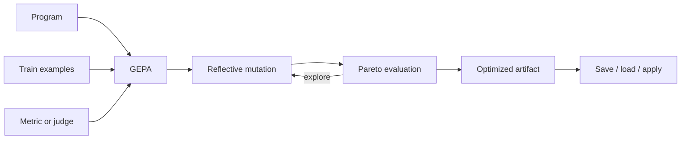

# {{optimizeName}} GEPA

{{optimizeIntro}}

```{{fence}}
{{optimizeCode}}
```

The optimizer runs a program against examples, scores predictions, searches for better instructions/demos/component settings, and returns an artifact that can be applied immediately or serialized.

## What It Does

GEPA explores changes and keeps tradeoffs visible through Pareto-aware results. The convenience helper runs bootstrap demos for small starter sets before GEPA, which gives the optimizer concrete examples to work with.



## Core Call Shape

```text
result = optimize(program, examples, metric, options)
program.applyOptimization(result.optimizedProgram)
```

Generated language packages expose the optimizer surface available in their AxIR API, usually as an `AxGEPA` engine.

### Baseline Reporting In TypeScript

TypeScript `optimize(...)` and `AxGEPA.compile()`, and generated-language GEPA engines and helpers, return `baselineScore` and `baselineScores` for the program before bootstrap or prompt changes. Generated artifacts also retain these fields in `metadata`, alongside `bestScore`. Existing caller-supplied demos are part of that baseline. Compare `bestScore - baselineScore` to report the change, even when the original candidate is no longer on the Pareto frontier.

Both scores use the same validation subset, sampling and metric or adapter. `baselineScores` holds averaged objective values (`{ score: value }` for scalar metrics), and `baselineScore` applies the same scalarization as `bestScore`. These fields are optional on the shared optimizer result because other optimizers may omit them. Save the baseline alongside the optimized artifact when recording experiments.

When bootstrap adds demos, allow two validation passes within `maxMetricCalls`; without new demos, GEPA reuses the initial evaluation. The helper's implicit budget is at least 100 and grows when needed to fit those passes; an explicit budget stays unchanged. Bootstrap demo generation retains its separate limits and collects fresh training rows, excluding stale held-out traces from inactive children. Generated artifacts report validation/search calls as `metadata.totalMetricCalls`, bootstrap calls as `metadata.bootstrapMetricCalls`, and their sum as `metadata.totalCalls`.

For Rust, use `optimize_with_client(&mut program, Rc<RefCell<Client>>, examples, options)` to evaluate a live student. The client-free `optimize(...)` helper requires explicitly pre-scored tasks. Supply an evaluator to `AxGEPA` when scoring predictions with an application-specific metric; the public GEPA examples demonstrate this in every language.

## Common Patterns

- Start with deterministic eval fixtures for the metric.
- Keep `maxMetricCalls` explicit.
- Use scalar metrics for one clear objective.
- Use multi-objective metrics for tradeoffs such as accuracy/cost or quality/brevity.
- Keep validation examples separate when the optimizer surface supports them.
- Save artifacts with enough metadata to explain the examples and metric that produced them.

### AxGen

{{optimizeAxGenExample}}

### Flow

{{optimizeFlowExample}}

### Agent

{{optimizeAgentExample}}

### Artifact

{{optimizeArtifactExample}}

## Production Notes

Optimization is a build-time or evaluation-time workflow, not something to hide in every request path. Track score history, cost, token usage, selected Pareto point, and the final artifact version.

See [optimize() API]({{langRoot}}/api/optimize/).
